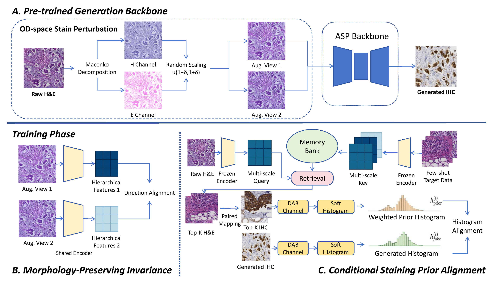

# DE_STAIN

Data-Efficient Cross-Domain H&E-to-IHC Stain Transfer via Morphology-Stain Decoupling.

## Overview

## Installation

Python 3.10 or later is required.

~~~bash
pip install -r requirements.txt
~~~

Alternatively:

~~~bash
conda env create -f environment.yml
conda activate DE_STAIN
~~~

## Data

Arrange paired H&E and IHC images with matching filenames:

~~~text
datasets/BCI_dataset/
  trainA/
  trainB/
  testA/
  testB/
~~~

A contains H&E images and B contains IHC images. The `HE/train`, `IHC/train`, `HE/test`, and `IHC/test` layout is also supported.

Place the pretrained ASP checkpoints under:

~~~text
checkpoints/mist_her2_lambda_linear/
  latest_net_G.pth
  latest_net_F.pth
  latest_net_D.pth
~~~

The checkpoint architecture must match the configuration.

## Usage

Set data and checkpoint paths in [configs/default.json](configs/default.json).

Training:

~~~bash
python train.py
~~~

Testing and evaluation:

~~~bash
python test.py
~~~

Command-line arguments override the configuration file. Pass `--gpu_ids -1` for CPU execution.

## Structure

~~~text
train.py      Training entry point
test.py       Testing and evaluation entry point
de_stain/     DE_STAIN modules
asp/          ASP backbone implementation
configs/      Configuration
assets/       Framework overview
~~~

## License

[MIT License](LICENSE).
